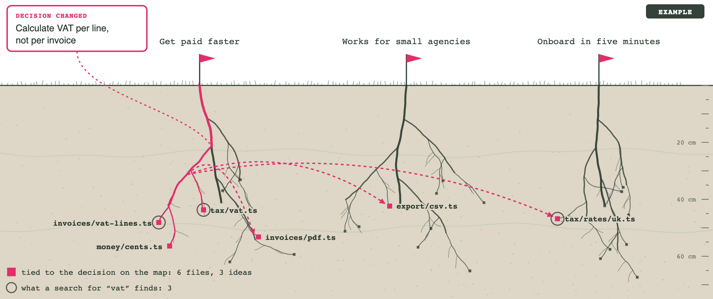

# Tillage

Connect Claude Code to a Tillage project map — an agent-native visual planner
where **the map is your project's context source of record**.

This plugin ships three things:

1. The **`map` skill** — set up a project on the task you are already on,
   orient from its map at the start of every session, and work its tasks.
   Rules, decisions, briefs, and memory live on map nodes, scoped by tree
   position, and your agent reads exactly the context that governs the node
   it is working on. Your project's `CLAUDE.md` becomes a small generated
   router stub that points at the map.
2. The **`tillage` MCP server** — a bundled local daemon that serves the
   map's tools directly. There is no endpoint URL, no token to paste, and no
   server to register: installing the plugin is the entire setup.
3. Ten **hooks** — small programs Claude Code runs at fixed moments of a
   session. Each adds one line of fact for your agent to read; none of them
   blocks an edit. What they read and when is listed under **The hooks** below.

## Requirements

**Node.js 22.12.0 or newer on your `PATH`.** The plugin ships a local daemon
that runs under whatever `node` it finds — plugin installation itself runs
nothing, so there is no install step to check this for you. Check with
`node --version`; if it is missing or older, install the current LTS from
[nodejs.org](https://nodejs.org/en/download) and reopen your terminal.

**Claude Code 2.1.287 or newer.** The hooks read the call id Claude Code hands
them from that version on; on an older one the map still works, but a
subagent's map call may be read from the wrong folder. Check with
`claude --version`.

Claude Code's own recommended install is a native binary that needs no Node
at all, so having Claude Code is **not** a guarantee that you have one.
`tillage` refuses to start on an older Node with a message saying so, rather
than half-working.

**No GitHub SSH key on this machine?** The repository is public, so no account
or credential is needed, but the `owner/repo` form below clones over SSH when
it can, and `/plugin` inside a session does not fall back to HTTPS on its own.
Set `CLAUDE_CODE_PLUGIN_PREFER_HTTPS=1` in the shell you start Claude Code
from, and installs and updates clone over HTTPS.

## Install (one-time)

In the Claude Code **terminal**:

```
/plugin marketplace add Reine0017/tillage
/plugin install tillage@tillage
```

Or non-interactively from any shell:

```
claude plugin marketplace add Reine0017/tillage
claude plugin install tillage@tillage
```

Plugin state is user-level (`~/.claude`), so whichever route you use, the
plugin is available everywhere Claude Code runs on your machine afterwards —
including the **desktop app**, which inherits the install without any step of
its own. The desktop app also has a plugin browser — **+** next to the prompt
box → **Plugins** → **Add plugin** — which lists the plugins of marketplaces you
have already added, so add the marketplace from a terminal first, then choose
your user account as the scope when you install from it. The install lands on
the next session start (or `/reload-plugins`); in that session `/mcp` lists
`tillage` as connected.

Tillage keeps your map in `~/.tillage` on your own machine, so it is built for
sessions that run there: your terminal, and the desktop app's local and SSH
sessions. Cloud sessions run on a remote machine and are not a good home for a
local-first map.

## Your first session

**Start Tillage in a repository.** Open Claude Code in the repository and type:

`/tillage:map set up this repo. I'm working on ‹your current task›`

Add a due date if it has one, for example "…, due 15 Oct". Tillage starts only
when you ask for it by name. Your agent asks who your work is for, opens the
map once your first proposition is placed (beside the chat in the desktop app,
or in your browser from a terminal), maps only the part of the code your task
lives in, checks your docs and rules there against the code, then works the
task with you. Your agent places propositions, approaches and slices only after
you say yes in the chat.

The map is a web page the daemon serves on your machine, at a `localhost`
address, and it updates live as your agent writes to it. When your agent
creates the map, the daemon ties it to this repository's directory, so every
later session opened here reaches the same map without being told. From then
on, every chat opened in this repository starts from the map without your
asking: your agent orients from it before it works.

**Three words on the map.** *Proposition*: something your product does for
someone, and what gets better for them. Example: "Shoppers get through
checkout in under a minute." Propositions sit at the top of the map; your agent
words them from what you say and checks the words with you. *Approach*: one way
the code delivers a proposition. Example: "Taking payment through the
processor's hosted checkout." If you change course, the old approach is parked:
it stays on the map, set aside, so you can see everything it touched. *Slice*:
a small piece of work under an approach, with what "done" means and its tasks.
Example: "Apple Pay at checkout", done when a shopper on iPhone can pay with
Apple Pay and the order shows as paid. Each slice is tied to the files it lives
in. Rules and decisions sit on the card they apply to; an agent working there,
or below it, is told them.

**When a rule changes after work was done under it.** Tillage keeps what
your agent was told for each task it took through the map, and changing a
rule later does not rewrite that. So when you change or drop a rule or a
decision by asking your agent, the map says how many finished tasks were
done under the old version, and "Flag them for a look" leaves a note on each
saying which rule or decision changed, before and after. The card holding
them reads "N flagged for a look" until the notes are closed, and they wait
for you on the map; your agent reads the note on its next work there. Ask
your agent and it names them too. "Flag them for a look" shows only when the
map knows your name, which it takes from the git user name of the repository
your project is linked to. When you set an approach or a slice aside, its
panel lists what it touched; "Show them" there marks the finished tasks done
under it, and "Flag them for a look" flags them the same way. Use it to
decide which work needs another look.



*An example, not your map: one decision changes, and Tillage shows every file it reached, across ideas.*

## What your agent's writes count as

Two kinds of thing land on the map: **structure** (nodes, slices, task rows)
and **guidance** (rules, decisions, memory). They are accepted differently,
and the difference depends on the git branch your agent is on:

> structure your agent writes from a checkout on `main` counts as accepted
> the moment it lands; guidance it proposes — rules, decisions, memory — is
> always yours to accept; have it work on a branch with at least one commit
> of its own if you want its structure held back until you merge — before
> that first commit a branch is `main` to git, so writes land accepted and
> only demote once the branch commits.

A card whose structure or tasks were written from a branch not yet on `main`
wears that branch's name on a small pill on its chip line (one pill per branch,
two then "+N"), and the pill leaves at the merge; a card with no pill is wholly
on `main`. Hover a pill to see the card's version on `main` beside the branch's.
Guidance proposals wait for your Keep, in the card's panel or on the Context
page, whatever the branch; to remove or correct an entry, tell your agent. You
add structure yourself in the creation box at the focus — `c`, the focus card's
`+`, or a double-click on empty canvas — and a proposition you set aside sits on
the Candidates strip at the top level until you unpark it.

## The hooks — what runs, and what it reads

A **hook** is a small program Claude Code runs by itself at a fixed moment of a
session, whose output your agent reads as context. Tillage ships ten. They
all run the same local program the MCP server runs, on your machine; none makes
a network call, and none stops your agent from editing a file or running a
command. They speak only in a directory a map claims — everywhere else they
say nothing.

| When it runs | What it reads | What it does |
| --- | --- | --- |
| Session start (also on resume, `/clear`, and after compaction) | your working directory, the file names `git status` shows there, and the `CLAUDE.md` at the top of its git checkout | Asks the local daemon which map claims this directory and tells the agent: the map, its link, how many notes wait, and that orienting is one `start_work` call. When that `CLAUDE.md` is missing or cannot be read, or differs from the stub, it says so. It starts the daemon if it is not running. |
| You send a prompt | **the text of your prompt**, on your machine only | Looks for a few fixed words. If the prompt names a kind of work (migrate, restructure, trace a bug), it names the playbook to read. If it states something durable ("always", "never", "from now on", "remember", "we decided"), it says such a statement is recorded on the map before the reply. Nothing is stored or sent. |
| Before a `start_work` call made by a subagent | the call's arguments | Turns the call into a peek, so a subagent's look does not change what your main agent is recorded as having been sent. |
| Before your agent starts a subagent, and after it moves with a worktree tool | your agent's working directory | Notes the folder your main agent is in, so a subagent's map call is read from your agent's branch, not the subagent's. Says nothing. |
| Before the agent writes or edits a file | the file's path | Notes the file's path as one this session edited. When the path is inside Claude Code's own per-project memory folder, it says the map is this project's memory. |
| Before a shell command | the command, and which commit your working directory is on, only when the command runs `git commit` | Notes that commit, so the moment after can tell whether a new commit landed on it. Says nothing. |
| After a shell command | the command and its output, and which commit your working directory is on, only when the command ran `git commit` | Says a commit landed and that its task row records it. |
| After a map write | the tool's name and whether it succeeded | Notes that this session recorded something on the map, and, when the write created a new map inside a repository, that a map now claims this directory. Says nothing. |
| End of a reply | `git status` in your working directory, the file names it showed when the session started, the map's bound paths, and the paths of the files this session edited | Only when this session changed a file and nothing was recorded on the map. When uncommitted changes sit under paths a slice owns, it tells the agent so, and the agent answers before ending its turn — by recording the work or saying why not. Once a session, it also asks the local daemon which of the files this session changed no slice claims, tells the agent, and the agent offers to map them or says they do not belong on the map. This is the one hook that holds a reply open; it refuses nothing. |

The notes the hooks leave for each other are small marker files under Claude
Code's plugin data directory (`~/.claude/plugins/data/tillage/` when Claude
Code does not name one), in a folder per session, removed after seven days.
Most are empty; one lists the files this session edited, one the file names
`git status` showed when the session started, and while a `git commit` runs,
one holds the commit it started from.
There is no switch per hook: the plugin is the switch. Disable the plugin, or
turn hooks off in Claude Code, and none of them runs.

## Where your data lives — and what is recorded

This release is local-only by design: all project data lives on your machine,
under the daemon's store (`~/.tillage`). Your agent talks only to a local
daemon over localhost; the daemon is the single store of record, and the map
UI is served by the same local daemon, in your browser. The published plugin
contains no cloud coordinates and makes no network calls. Cloud sync returns
in a later release.

Tillage records, locally on your machine, what the map served your agent and
what was written back; nothing leaves it.

## Readable code, and the license

The plugin's built files ship unminified, so you can read what runs on your
machine: the daemon under `dist/` and the map's web app under `dist/app/`.
They are built files, not the source repository, which is not published.

The license is the Functional Source License, version 1.1, with Apache 2.0 as
the future license (`FSL-1.1-ALv2`; the full text is in
[LICENSE](../LICENSE) at the root of this repository). In plain words: you may
use, copy, change and redistribute each version for any purpose, inside a
company included, except to offer it to others as a product or service that
competes with Tillage. Two years after a version is released, that version
also becomes available under the Apache License 2.0. Team seats on the cloud
version come in a later release.

## Known issues in this release

Unbuilt features are stated here, never hidden. The list:

- **No in-app "connect repository".** Your agent binds the directory when it
  creates the project (above).
- **Narrow windows.** Below about 760px wide, the bottom-centre view tabs
  overlap a corner of the open TYPE legend. The tabs stay clickable; widen the
  window. Below about 1,060px wide with a card's panel open, the panel that
  appears when a task is finished can run under the card's panel or past the
  canvas's left edge, cutting its heading; widen the window or close the card's
  panel.
- **The Context page opened from the top level.** The Candidates strip and the
  view tabs draw over the bottom of the page; scroll to see what they cover.
- **Upgrading from 0.14.1 or earlier: a map holding a task row your agent
  added without an id is unsupported.** 0.14.2 fixes the cause (the daemon gave
  such a row a different id each time it rebuilt the map, so a later "mark it
  done" was refused as "No row … on node …"), but a map already written that
  way replays to no row rather than refusing to open. Delete that project from
  the daemon's store and onboard again; every row added on 0.14.2 carries the
  id your agent minted.
- **No undo.** A card or an entry you made by hand on the map cannot be reversed
  by hand. Ask your agent in the chat to remove it; it does, and records why.
- **A squash merge loses the link from `main`'s commits back to your tasks.**
  Your rows keep their commits and records, but no commit on `main` names them.
  Merge with a merge commit.
- **A slice placed as planned keeps its target sentence, not its files, until
  your agent binds them.** After its first task is finished, ask your agent to
  set the slice active and name the files it touched; until then "See the files
  for each slice" shows none for it.
- **"Flag them for a look" leaves the notes; it does not move the view.** The
  card holding the tasks reads "N flagged for a look"; open it to see them.
- **Some refusal messages cite a "spec" section.** For example "(structure spec
  §7)". That is an internal design document, not something you or your agent
  can open; the sentence before the citation states the rule in full.

## Versioning

The plugin version tracks the bundled skill: skill `version: N` → plugin
`0.N.x`. Patch releases are packaging-only.
